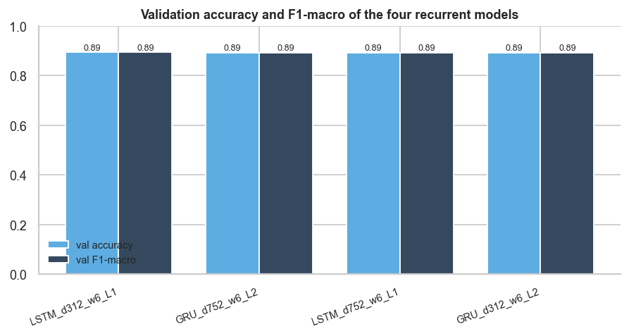
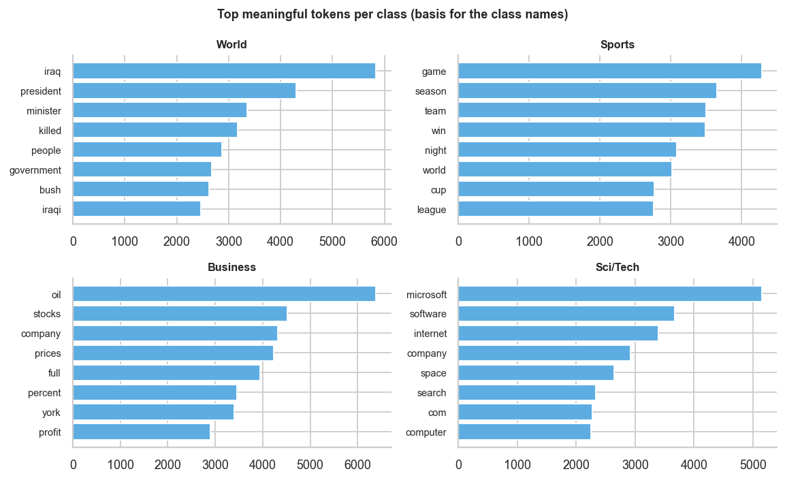
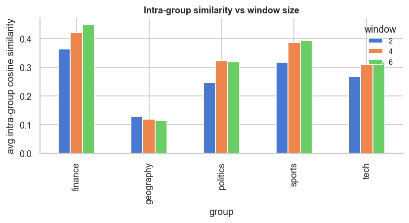
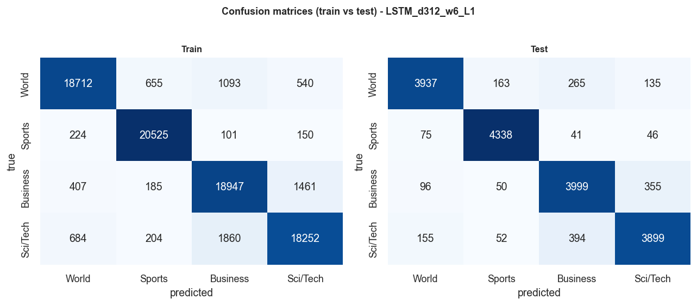

# Del texto en bruto a la categoría: Skip-Gram propio + LSTM/GRU sobre AG News

> Sin embeddings preentrenados, sin atajos. Primero la red aprende **qué significan las palabras**
> leyendo 120 000 noticias; después, otra red aprende **de qué va cada noticia** usando solo ese
> vocabulario aprendido. Todo en PyTorch, desde cero.

| Modelo (embedding congelado) | Capas | Learning rate | Val macro-F1 |
|---|---|---|---|
| **LSTM** · d312, ventana 6 | 1 | 0.001 | **0.894** |
| GRU · d752, ventana 6 | 2 | 0.0005 | 0.893 |
| LSTM · d752, ventana 6 | 1 | 0.001 | 0.892 |
| GRU · d312, ventana 6 | 2 | 0.0005 | 0.892 |

**Mejor modelo en test (18 000 noticias): accuracy y macro-F1 de 0.898.** Con 20 titulares reales de
2026, fuera del corpus: 18 aciertos.



---

## Índice

- [El pipeline de un vistazo](#el-pipeline-de-un-vistazo)
- [Los datos](#los-datos)
- [Etapa 1: enseñar a la red qué significan las palabras](#etapa-1-enseñar-a-la-red-qué-significan-las-palabras)
- [Etapa 2: de palabras a categorías](#etapa-2-de-palabras-a-categorías)
- [Lo que me llevo](#lo-que-me-llevo)
- [Siguientes pasos](#siguientes-pasos)
- [Cómo ejecutarlo](#cómo-ejecutarlo)

---

## El pipeline de un vistazo

```
120 000 noticias ──► limpieza + vocabulario (3 000 palabras)
                        │
                        ▼
                 Skip-Gram × 6  (dim 312/752 × ventana 2/4/6)
                        │   evaluados con distancia coseno + separación de clases
                        ▼
              embeddings congelados ──► LSTM / GRU ──► World · Sports · Business · Sci/Tech
```

- **Todo a mano.** Skip-Gram, entrenamiento, F1-macro, matriz de confusión y split estratificado
  implementados en PyTorch y numpy.
- **Corpus completo en GPU.** Los pares de entrenamiento (≈114 M filas con 5 negativos por positivo) se
  generan ventana a ventana y se liberan, lo que permite entrenar con las 120 000 noticias.
- **Vocabulario limpio.** Fuera stopwords, nombres de agencia ("reuters", "ap") y fechas: las palabras
  frecuentes pasan a ser world, company, oil, iraq…

## Los datos

AG News (Zhang et al., 2015): 120 000 noticias, 30 000 por categoría (World, Sports, Business,
Sci/Tech). Título y descripción unidos, en minúsculas y sin HTML ni signos. Mediana de 23 palabras por
noticia tras limpiar.



## Etapa 1: enseñar a la red qué significan las palabras

Skip-Gram con negative sampling: embedding, producto escalar, sigmoide, *binary cross-entropy* y Adam;
10 épocas con el corpus completo. ¿Funciona? Mira a los vecinos más cercanos:

| Palabra | Vecinos |
|---|---|
| oil | crude, prices, barrel |
| iraq | baghdad, troops |
| space | nasa, spacecraft |
| software | microsoft, computer, server |



| Grupo | d312 w2 | d312 w4 | d312 w6 | d752 w2 | d752 w4 | d752 w6 |
|---|---|---|---|---|---|---|
| politics | 0.72 | 0.65 | 0.65 | 0.79 | 0.71 | 0.71 |
| sports | 0.65 | 0.56 | 0.57 | 0.72 | 0.67 | 0.64 |
| finance | 0.62 | 0.56 | 0.53 | 0.65 | 0.60 | 0.57 |
| technology | 0.70 | 0.66 | 0.65 | 0.76 | 0.72 | 0.71 |
| geography | 0.87 | 0.87 | 0.89 | 0.87 | 0.89 | 0.88 |

*Distancia coseno media (menor = palabras más cercanas).* De ventana 2 a 4 los grupos temáticos se
compactan claramente y a partir de 4 se estabilizan. Más dimensiones no es mejor: el embedding de 312
agrupa mejor que el de 752, que reparte la información en más dimensiones de las que el corpus puede
llenar.

## Etapa 2: de palabras a categorías

Noticias convertidas a índices y ajustadas a 40 tokens, con *masked mean pooling* sobre la salida
recurrente. Split estratificado 70/15/15. Los dos embeddings comparados usan ventana 6, así que la única
diferencia entre ellos es la dimensión.



- Train y test casi idénticos: generaliza sin sobreajuste apreciable.
- **Sports** es la clase más clara (F1 0.95). **Business** y **Sci/Tech** (F1 0.87) se confunden entre
  sí porque comparten vocabulario: company, market, technology.
- En los 20 titulares reales de 2026 acierta 18; los dos fallos vuelven a caer en la frontera
  Business / Sci/Tech.

## Lo que me llevo

- Unos embeddings entrenados solo con el corpus bastan para clasificar noticias con un **0.898 de
  macro-F1**.
- Cuando el embedding ya captura los temas, el resto (dimensión, LSTM o GRU) mueve el resultado en
  milésimas: **la representación es lo que manda**.
- Las confusiones que quedan reflejan un solapamiento real entre categorías: la economía y la
  tecnología hablan el mismo idioma.

## Siguientes pasos

- Permitir que el clasificador ajuste los embeddings (*fine-tuning*) en lugar de congelarlos.
- Negative sampling por frecuencia y un vocabulario mayor.
- Comparar LSTM y GRU con la misma profundidad y learning rate, y varias semillas.
- Un test web más amplio para medir el comportamiento fuera del corpus.

## Cómo ejecutarlo

Python 3.12 con `torch` (CUDA recomendado), `numpy`, `pandas` y `matplotlib`. AG News no está incluido
por tamaño: descárgalo de
[Kaggle](https://www.kaggle.com/datasets/amananandrai/ag-news-classification-dataset) y guárdalo como
`news_dataset.csv`. Ejecuta los notebooks en orden: el primero genera los embeddings que usa el
segundo.

```
01_skipgram_embeddings.ipynb      seis embeddings Skip-Gram y su evaluación
02_lstm_gru_clasificacion.ipynb   LSTM/GRU, test y titulares web
figures/                          figuras exportadas
```

---

Proyecto desarrollado durante el Grado en Ingeniería de Sistemas de Inteligencia Artificial
(Universidad Francisco de Vitoria, 2025/26). Autor: Marco Larriba Rius.
